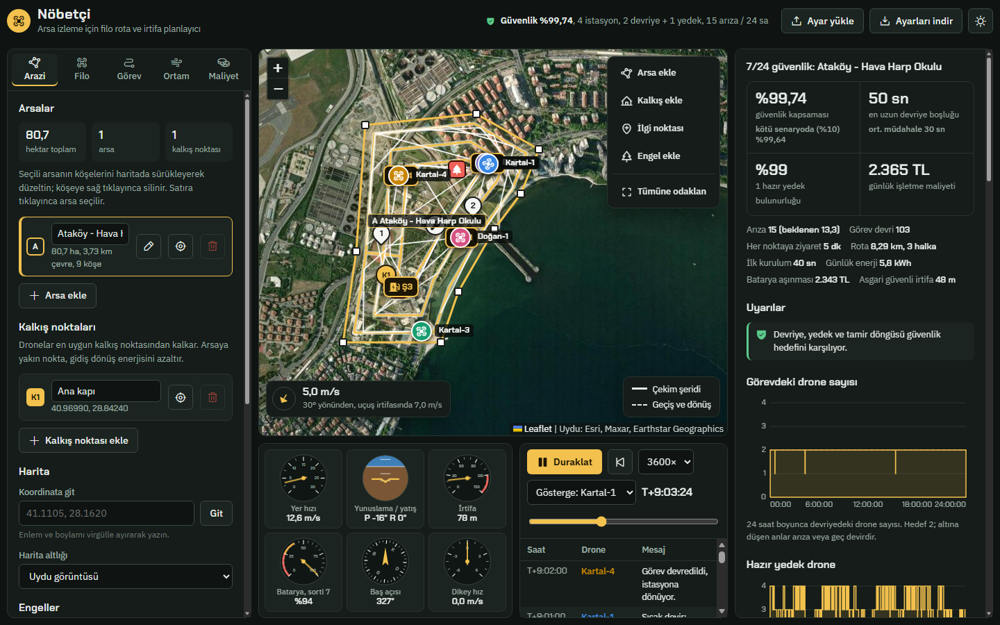

# Nöbetçi: Drone Rota ve İrtifa Planlayıcı

Bir veya birden fazla arsayı drone filosuyla sürekli izlemek için rota, irtifa ve drone seçimi planlayan tarayıcı uygulaması.
Yakıt ve enerji tasarrufu ile zaman tasarrufu arasındaki dengeyi siz seçersiniz; plan her değişiklikte yeniden hesaplanır.



**Teknoloji:** Bağımlılıksız (vanilla) JavaScript, Leaflet harita, Web Worker ile arka planda hesap. Çalıştırmak için yalnızca Node.js (18 veya üstü) gerekir.

## Hızlı başlangıç (Windows)

0. **Klasörün tamamını indirin:** GitHub depo sayfasında yeşil **Code** düğmesi → **Download ZIP**. Zip'e sağ tıklayıp **Tümünü ayıkla** deyin. `.bat` dosyasını tek başına indirmeyin ve zip'in içinden çalıştırmayın; yanında `kurulum.ps1`, `sunucu.js` ve `uygulama/` olmalıdır.
1. Ayıklanan klasörde `1_KUR_VE_CALISTIR.bat` → Node.js yoksa kurar (winget), hesap motoru testlerini çalıştırır ve uygulamayı tarayıcıda açar.
2. Sonraki açılışlarda `2_BASLAT.bat` yeterlidir.
3. Tarayıcı açılmazsa **http://127.0.0.1:8080/** adresine gidin (8080 doluysa sunucu bir sonraki boş bağlantı noktasını kullanır ve adresi pencerede yazar).

Uydu haritası ve ikonlar internetten yüklendiği için internet bağlantısı gerekir.

### Elle çalıştırma (Windows, macOS, Linux)

```bash
npm start      # sunucuyu başlatır ve tarayıcıyı açar
npm test       # hesap motoru testleri
```

## Neler yapar

- **Dış drone tehdidi:** Tek, sürü, çok yönlü, yem, bekleme ve hızlı sabit kanat saldırılarına karşı tespit (radar, RF, EO/IR, akustik, devriye kamerası) ve önleme (RF karıştırma, ağlı önleyici drone) benzetimi; sensör yerleşimi, kör sektör analizi ve önleyici sayısı önerisi (bkz. [Dış drone tehdidi](#dış-drone-tehdidi-tespit-ve-önleme)).
- **7/24 güvenlik devriyesi (varsayılan görev):** Varsayılan alan, Bakırköy'de Ataköy Konakları ile Hava Harp Okulu arasıdır (Ayamama kanalı, sahil, Rauf Orbay Caddesi; yaklaşık 81 ha). Uygulama bu alan için şunları hesaplar:
  - aynı anda kaç drone'un devriyede olacağı ve kaç hazır yedek tutulacağı (güvenlik hedefi),
  - drone sayısına ve şarj yuvasına göre şarj/kalkış istasyonlarının sayısı ve yeri,
  - tamir istasyonunun yeri,
  - görev devirleri, batarya değişimleri, şarj kuyruğu,
  - rastgele arızalar ve tamir süreci (bkz. [Güvenlik algoritması](#güvenlik-algoritması)).
- **Birden fazla arsa ve kalkış noktası:** Haritada çizilir, sürüklenerek düzeltilir.
- **Otomatik drone seçimi:** Her drone, arsa ve kalkış noktası çifti için rüzgâr sınırı, menzil, iş hızı, hektar başına enerji, yedek batarya ve şarj süresi hesaplanır. Öncelik ayarına göre en uygun dronelar seçilir, gerisi nedeniyle birlikte yedekte gösterilir. İstenirse atama elle yapılır.
- **İrtifa belirleme:** Hedef görüntü çözünürlüğünden (cm/piksel) irtifa hesaplanır; en yüksek engel, güvenlik payı, arazi kot farkı ve yasal üst sınır (varsayılan 120 m) arasına çekilir. Aynı arsayı veya kalkışı paylaşan dronelar ayrı irtifa katmanlarında uçar.
- **Üç görev türü daha:** Alan tarama (bindirmeli şeritler), çevre devriyesi, ilgi noktası kontrolü (en kısa ziyaret sırası).
- **Çevre devriyesinde en geniş görüş:**
  - Görevdeki dronelar çevreye eşit aralıkla yayılır. Her drone önündeki aralığa göre hızını ayarlar: aralık büyükse hızlanır, küçükse yavaşlar. Bir drone batarya değiştirmeye gidince kalanlar aralığı kendiliğinden yeniden eşitler.
  - İlk kalkışta dronelar doğrudan eşit aralıklı noktalara gider. Sonradan katılan drone en büyük boşluğun ortasına girer.
  - İlk bataryalar kademeli kullanılır; böylece sonraki batarya değişimleri çakışmaz.
  - İrtifa, kabul edilen en kaba görüntü çözünürlüğüne (varsayılan 5 cm/px) ve yasal sınıra kadar yükseltilir; her drone daha geniş alan görür.
  - Sonuç panelinde anlık çevre görüşü, en uzun bekleme süresi ve aralık düzgünlüğü, dağıtmadan uçan filoyla karşılaştırmalı gösterilir.
- **Sürekli gözlem:** Gözlem süresi boyunca döngüler tekrarlanır; batarya değişimi, yedek batarya ve şarj sırası planlanır. Her arsa için tekrar aralığı, görevdeki drone sayısı ve boş kalınan süre gösterilir.
- **Enerji modeli:** Çok rotorlu ve sabit kanat güç modelleri, rüzgârın irtifayla artışı, hava yoğunluğu, sıcaklığın bataryaya etkisi, dönüş kayıpları, benzinli dronelar için yakıt tüketimi.
- **Simülasyon:** Haritada canlı uçuş, her drone'un kamera görüş alanı, 6 gösterge (hız, yönelim, irtifa, batarya, baş açısı, dikey hız) ve zaman damgalı kayıt tablosu. Haritadaki veya simülasyon çubuğundaki **Büyüt** düğmesi yan panelleri gizleyip haritayı tam ekrana açar (Esc ile çıkılır).
- **Dışa aktarma:** Her drone için QGroundControl'ün açabileceği `.plan` görev dosyası; tüm ayarları JSON olarak indirme ve geri yükleme.

## Güvenlik algoritması

Öncelik sırası sabittir: **güvenlik > hazır yedek > enerji ve süre.**

1. **Devriye rotası:** Alan, kamera izi genişliğinde iç içe halkalarla kaplanır ve tek kapalı rota oluşturulur. Hedef sayıda "devriye yuvası" bu rotada eşit aralıkla döner; her yuvada her an bir drone bulunması hedeflenir.
2. **Şarj ve kalkış istasyonları:**
   - **Sayı:** en az `uygun drone ÷ istasyon başına şarj yuvası` istasyon kurulur. 4 ve üzeri dronede, tek bir istasyonun devre dışı kalmasına karşı en az 2 istasyon olur. Rotanın en uzak noktası en kısa menzilin dörtte birinden uzaksa sayı artırılır.
   - **Konum:** rotaya ortalama mesafeyi en aza indiren p-medyan çözümüyle seçilir (önce açgözlü başlangıç, sonra takas iyileştirmesi).
3. **Tamir istasyonu:** Arıza noktalarına gidiş ve tamirden sonra istasyonlara teslim yolunun toplamını en aza indiren konum.
4. **Görev devri (sıcak devir):** Görevdeki drone'un rezerv sınırına kalan süresi, en yakın hazır drone'un varış süresi artı devir payına inince yedek kalkar. Yedek yuvaya vardığında görevdeki drone istasyonuna döner; böylece devirlerde boşluk oluşmaz.
5. **Batarya ve şarj:** Biten batarya, istasyondaki şarj yuvalarında sırayla şarj edilir. Şarjlı yedek batarya yoksa drone şarjın bitmesini bekler.
6. **Rastgele arızalar:** Uçuştaki her drone, ortalama arızalar arası süreyle (MTBF) rastgele arızalanır.
   - **Kritik arıza:** acil iniş; kurtarma aracı drone'u tamir istasyonuna taşır.
   - **Hafif arıza:** drone uçarak tamir istasyonuna gider.
   - Tamir bitince drone istasyonuna teslim edilir ve yeniden yedeğe katılır.
   - Arızada en yakın hazır drone hemen boş yuvaya kalkar. Güvenlik için gerekirse son yedek de kullanılır.
7. **En iyi düzenin seçimi:** Her istasyon sayısı, çok sayıda farklı rastgele arıza senaryosuyla (Monte Carlo) 24 saat benzetilir. Seçim sırası:
   1. kötü senaryolardaki (%10) kapsama,
   2. hazır yedek bulunurluğu,
   3. enerji,
   4. daha az istasyon.
8. **Filo yeterliliği:** Her drone'un devriyede geçirebildiği zaman oranı ile arıza ve tamir kaynaklı kullanılamazlık hesaplanır. Hedef için gereken asgari drone sayısı önerilir; filo yetersizse kritik uyarı verilir.

Benzetim 10 saniyelik adımlarla çalışır ve aynı rastgelelik tohumuyla aynı sonucu verir. Bulunan istasyonlar "İstasyonları kalkış noktası yap" düğmesiyle kalkış noktası olarak kaydedilebilir.

## Dış drone tehdidi: tespit ve önleme

7/24 güvenlik görevinde, alana dışarıdan bir veya birden fazla drone ile saldırı senaryoları benzetilir. Bu bölüm savunma amaçlı bir planlama aracıdır. Saldırgan dronlar yalnızca yön, irtifa, hız, sayı ve radyo yayını gibi genel özelliklerle modellenir.

**Senaryolar** (kamuya açık karşı-İHA literatüründeki genel tehdit sınıfları):

| Senaryo | Özet |
|---|---|
| Tekil doğrudan yaklaşma | Tek drone, rastgele yön, 60-110 m, korunan noktaya düz uçuş |
| Alçak irtifadan sızma | 15-30 m; radar yer yansımasında menzil kaybeder |
| Sürü (doygunluk) saldırısı | 6-10 drone aynı sektörden; radar iz kapasitesi ve önleyici sayısı zorlanır |
| Çok yönlü eş zamanlı saldırı | 3 drone, aralarında yaklaşık 120°, aynı anda |
| Yem ve asıl saldırı | RF yayan 2 yem drone; 60-90 sn sonra karşı yönden alçak, otonom asıl drone |
| Keşif, bekleme ve dalış | Sınırın 300 m dışında 2 dk bekleme, sonra dalış |
| Hızlı sabit kanat | 25-35 m/s, 80-120 m; erken uyarı süresi kısalır |

**Tespit katmanı:**
- Sensörler: radar, RF dedektör, EO/IR kamera, akustik sensör ve devriye dronelarının kameraları. Her sensör mesafeye, irtifaya ve hedefin radyo yayınına bağlı olasılıkla tespit yapar.
- RF dedektör otonom (radyo yaymayan) dronları göremez.
- Radar alçak irtifada menzil kaybeder; ayrıca bir radarın aynı anda izleyebileceği hedef sayısı sınırlıdır.
- EO/IR kamera, başka bir sensör hedefi işaret etmeden önce düşük olasılıkla arama yapar.

**Füzyon ve angajman kuralı:**
1. **İz:** herhangi bir sensörün ilk tespiti.
2. **Doğrulama:** iki farklı sensör, üç radar tespiti ya da EO/RF/devriye görüşü.
3. **Sınıflandırma:** görsel tanımlama, RF imzası ya da sınırın geçilmesi (alan ihlali kuralı).

Sınıflandırmadan sonra, ayarlanabilir karar süresi dolunca müdahale başlar. İz doğrulandığı hâlde görsel tanımlama yoksa en yakın devriye drone'u tanımlama için yönlendirilir. Bu sırada devriyeden ayrılan süre ölçülür.

**Önleme katmanı:**
- **RF karıştırıcı:** alan etkilidir, otonom dronlara etkisizdir.
- **Ağlı önleyici drone:** kesişme noktasına yönelen öncül takip yapar, en fazla üç yakalama denemesi yapar, sonra yeniden donanır.

**Yerleşim:** Sensörler ve karıştırıcılar, 36 yaklaşma yönü ve üç tehdit profili (80 m, 25 m ve 25 m otonom) için erken uyarı mesafesini en büyüten açgözlü seçimle yerleştirilir. Kör sektörler kutup grafiğinde gösterilir.

**Ölçüm:** Her senaryo çok sayıda rastgele denemeyle tekrarlanır. Ölçülenler:
- tespit oranı ve ortalama tespit mesafesi,
- erken uyarı süresi ve karar süresi,
- etkisizleştirme ve sızma oranı,
- yem senaryosunda asıl tehdidin sızma oranı,
- devriyeden ayrılan süre,
- önleyici sayısına göre sızma (duyarlılık analizi).

Sonuç panelindeki oynat düğmesi, o senaryodan örnek bir saldırıyı haritada gösterir.

**İstediğiniz anda saldırı gönderme ve planlama** (haritanın sol üstü):
- **Rastgele saldırı:** seçili senaryolardan 1-3 dalgayı, birbirinden en az 60° ayrık yönlerden hemen gönderir. Simülasyon 10× hızda oynamaya başlar.
- **Saldırı planla:** her dalga için senaryo (veya rastgele), geliş yönü (derece, rastgele ya da haritaya tıklayarak), drone sayısı, gecikme ve bağlantı türü (karışık, otonom, RF bağlantılı) seçilir. Saldırı hemen ya da belirli bir simülasyon saatinde (T+sa:dk) başlar. En fazla 8 dalga ve 20 saldırı planlanabilir.
- Birden çok dalga, aynı anda farklı yerlerden saldırı demektir. Tüm saldırılar tek benzetimde çalışır: sensörler, karıştırıcılar ve önleyici dronlar ortaktır. Önceki saldırıda yeniden donanan önleyici sonrakine hazır olmaz.
- Her tehdidin kendi rastgele akışı vardır; sonradan eklenen saldırı, öncekinin geçmişini değiştirmez.
- Hızlı oynatmada planlı bir saldırıya yaklaşılınca hız kendiliğinden 10×'e düşer. Her saldırı bitince tespit, etkisizleştirme ve sızma özeti kayda yazılır.
- Saldırı planları tarayıcıda saklanır ve plan değişince yeni sensör yerleşimiyle yeniden benzetilir.

**Varsayılan menziller kaba değerlerdir:** radar 1,5 km, RF 2 km, EO/IR 0,8 km, akustik 250 m, karıştırıcı 1 km. Gerçek ürün verisiyle değiştirilmelidir. Karıştırma ve fiziksel önleme araçlarının kullanımı mevzuata tabidir ve yalnız yetkili güvenlik birimlerince uygulanabilir.

Dayanılan kaynaklar:
- Park, S. ve ark. (2021). *Survey on Anti-Drone Systems: Components, Designs, and Challenges.* IEEE Access 9:42635-42659, doi:10.1109/ACCESS.2021.3065926. Bu derleme tespit, tanımlama ve etkisizleştirme sınıflandırmasını verir.
- Wang, J., Liu, Y., Song, H. *Counter-Unmanned Aircraft System(s) (C-UAS): State of the Art, Challenges, and Future Trends.* IEEE Aerospace and Electronic Systems Magazine, doi:10.1109/MAES.2020.3015537 (arXiv:2008.12461). Tespit yöntemlerini (akustik, görüntü, pasif RF, radar, füzyon) ve etkisizleştirme yöntemlerini derler.
- Katmanlı sensör yaklaşımı, RF'nin otonom dronlara karşı körlüğü ve sürü ile yem saldırısı zorlukları üretici ve sektör kaynaklarında da vurgulanır. Bu kaynaklar hakemli değildir; ayrıntılar için hakemli derlemeleri esas alın.

## Klasörler

| Klasör / dosya | İçerik |
|---|---|
| `uygulama/index.html` | Uygulamanın tamamı: arayüz, stiller ve `<script id="motor">` içindeki hesap motoru. |
| `testler/motor.test.js` | Hesap motoru testleri (`npm test`). |
| `araclar/csp-guncelle.js` | `index.html` içindeki betikler değişince güvenlik politikasındaki (CSP) özetleri yeniler (`npm run csp`). |
| `sunucu.js` | Yalnızca `uygulama/` klasörünü ve yalnızca bu bilgisayara (127.0.0.1) sunan küçük yerel sunucu. |
| `kurulum.ps1` | `1_KUR_VE_CALISTIR.bat` tarafından çalıştırılan kurulum betiği. |
| `docs/` | README görselleri. |

## Geliştirme notları

- `uygulama/index.html` içindeki bir betiği değiştirdikten sonra `npm run csp` çalıştırın; aksi halde tarayıcı güvenlik politikası betiği engeller.
- Hazır drone sınıfları yaklaşık değerlerdir. Filo sekmesine kendi dronelarınızın ağırlık, batarya ve kamera bilgilerini girin.
- Uygulama bir planlama aracıdır; drone'a canlı bağlanmaz. İndirilen `.plan` dosyasını uçuştan önce yer kontrol istasyonunda mutlaka kontrol edin ve yerel havacılık kurallarına uyun.

## GitHub'a yükleme

GitHub'da boş bir depo oluşturun (README eklemeden), sonra bu klasörde:

```bash
git init
git add .
git commit -m "Nöbetçi drone planlayıcı"
git branch -M main
git remote add origin https://github.com/KULLANICI_ADI/DEPO_ADI.git
git push -u origin main
```

## Yararlanılan kaynaklar

Rota ve enerji fikirleri için incelenen açık kaynak projeler: udacity/CppND-Route-Planning-Project ve a-ngo/route-planning (A\*), cuntou0906/Route-Planning (GA, PSO, ACO), RoutingKit (CH, CCH), Telecominfraproject/oopt-gnpy, Dungyichao/Electric-Vehicle-Route-Planning (enerji ödüllü rota), Kasheftin/RoutePlanner (harita arayüzü). Arayüz düzeni Mali03/UAV-interface yer kontrol istasyonundan uyarlanmıştır. Döner kanat güç modeli: Zeng, Xu ve Zhang (2019).
