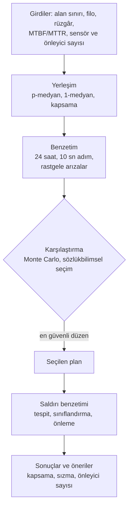
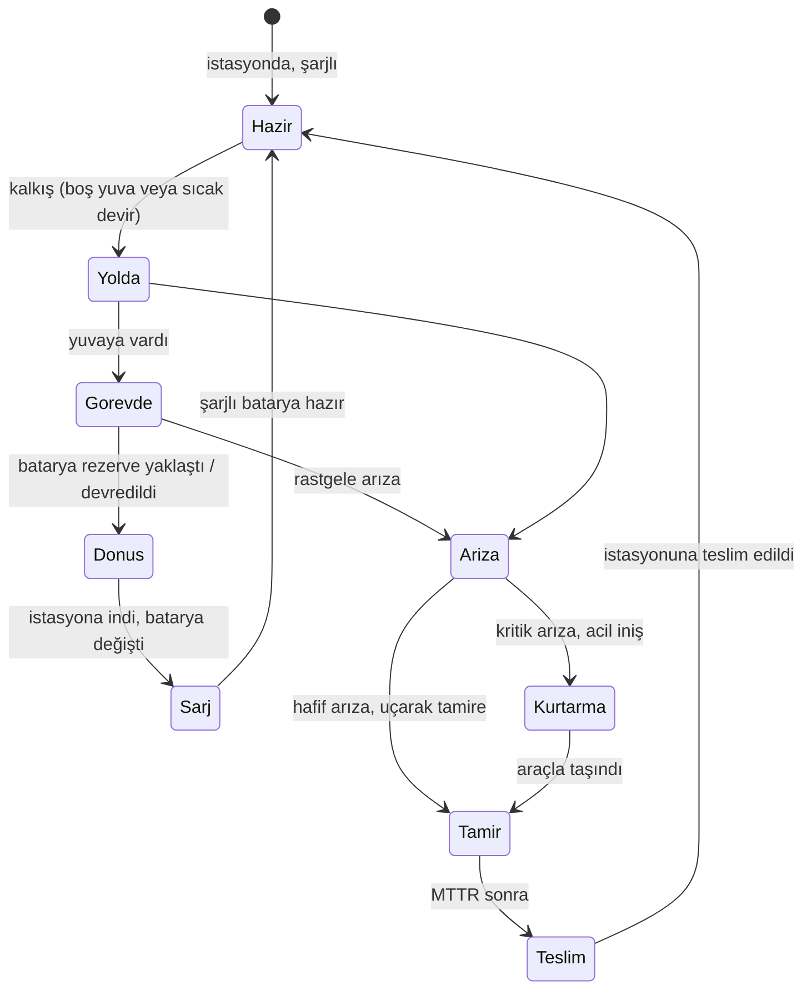
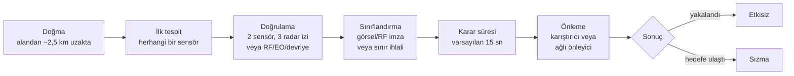

# Nöbetçi Simülasyonunu Anlamak İçin Rehber

Bu rehber, uygulamadaki 7/24 güvenlik devriyesi ve dış drone saldırısı simülasyonunu anlamak için gereken bilgileri bir araya getirir. Önce kullanılan endüstri mühendisliği yöntemlerini, sonra her birini anlamak için gereken ön bilgiyi, en son simülasyonun adım adım nasıl işlediğini ve sonuçların nasıl okunacağını anlatır.

Matematiksel modellerin tam yazımı (karar değişkenleri, amaç fonksiyonu, kısıtlar) için: [yoneylem-modelleri.md](yoneylem-modelleri.md).

## İçindekiler
1. [Büyük resim: simülasyon ne yapıyor?](#1-büyük-resim-simülasyon-ne-yapıyor)
2. [Kullanılan endüstri mühendisliği yöntemleri](#2-kullanılan-endüstri-mühendisliği-yöntemleri)
3. [Bilinmesi gereken ön bilgiler](#3-bilinmesi-gereken-ön-bilgiler)
4. [Simülasyon adım adım nasıl işliyor?](#4-simülasyon-adım-adım-nasıl-işliyor)
5. [Sonuçları okuma: ölçütler sözlüğü](#5-sonuçları-okuma-ölçütler-sözlüğü)
6. [Parametreler ve beklenen etkileri](#6-parametreler-ve-beklenen-etkileri)
7. [Kendiniz deneyerek öğrenin: 8 deney](#7-kendiniz-deneyerek-öğrenin-8-deney)
8. [Varsayımlar ve sınırlar](#8-varsayımlar-ve-sınırlar)
9. [Kod haritası](#9-kod-haritası)
10. [Okuma listesi](#10-okuma-listesi)

---

## 1. Büyük resim: simülasyon ne yapıyor?

Uygulama üç soruyu birlikte yanıtlar:

1. **Nereye kurayım?** Şarj ve kalkış istasyonları, tamir istasyonu, sensörler ve karıştırıcılar nereye konmalı? *(tesis yerleşimi)*
2. **Nasıl işleteyim?** Hangi drone ne zaman kalkar, ne zaman devreder, batarya ve şarj sırası nasıl yönetilir? *(çizelgeleme ve atama)*
3. **Ne kadar güvenliyim?** Rastgele arızalar ve dış saldırılar altında devriye kesintisiz sürüyor mu, saldırılar durduruluyor mu? *(stokastik benzetim ve risk ölçümü)*

Uygulama bir **karar destek sistemidir**: en iyi düzeni kesin olarak ispatlamaz. Aday düzenleri üretir, her birini çok sayıda rastgele senaryoyla dener ve güvenliği en yüksek olanı seçer.

---

## 2. Kullanılan endüstri mühendisliği yöntemleri

| # | Yöntem | Uygulamada nerede | İlgili ders veya konu |
|---|---|---|---|
| 1 | **Ayrık olay ve sabit adımlı benzetim** | 24 saatlik devriye (10 s adım), saldırı (1 s adım) | Benzetim (Simülasyon) |
| 2 | **Monte Carlo yöntemi** | Her düzen 12 arıza senaryosuyla, her saldırı türü 20 denemeyle | Benzetim, Olasılık |
| 3 | **Güvenilirlik analizi** (MTBF, MTTR, kullanılabilirlik) | Rastgele arızalar, tamir, filo kapasitesi | Güvenilirlik ve Bakım Mühendisliği |
| 4 | **Tesis yerleşimi: p-medyan** | Şarj ve kalkış istasyonlarının yeri | Tesis Planlama, Yöneylem Araştırması |
| 5 | **Tek tesis yerleşimi: 1-medyan** | Tamir istasyonunun yeri | Tesis Planlama |
| 6 | **En büyük kapsama yerleşimi** | Radar, RF, kamera, akustik sensör ve karıştırıcı yerleri | Tesis Planlama (kapsama modelleri) |
| 7 | **Kapasite planlama ve görev oranı** | Kaç drone gerekir; batarya ve şarj darboğazı | Üretim Planlama, Kapasite Planlama |
| 8 | **Kuyruk (sıra) sistemi** | Şarj yuvalarında ilk gelen ilk çıkar sırası | Kuyruk Teorisi |
| 9 | **Yedek parça ve emniyet stoğu mantığı** | Hazır yedek drone ve yedek bataryalar | Envanter (Stok) Yönetimi |
| 10 | **Rotalama: GSP, en yakın komşu ve 2-opt** | Alan tarama ve noktasal kontrol turları | Araç Rotalama, Kombinatoryal Optimizasyon |
| 11 | **Kapsama yol planlaması** | Biçerdöver (gidiş geliş) şeritleri, iç içe devriye halkaları | Rotalama, Robotik yol planlama |
| 12 | **Çizelgeleme ve dağıtım kuralları** | Görev devri (sıcak devir), en acil tehdide önleyici atama | Çizelgeleme |
| 13 | **Atama problemi** | Drone ile arsa/kalkış noktası, drone ile istasyon eşleştirme | Yöneylem Araştırması |
| 14 | **Çok amaçlı karar verme** | Sözlükbilimsel seçim (güvenlik önce); enerji ve süre dengesi | Çok Kriterli Karar Verme |
| 15 | **Sezgisel yöntemler** | Açgözlü seçim, takas iyileştirmesi, yerel arama | Sezgisel Optimizasyon |
| 16 | **Risk ölçüleri ve yüzdelikler** | Kötü senaryo kapsaması (%10 alt yüzdelik), en uzun boşluk (%90) | İstatistik, Risk Analizi |
| 17 | **Şans kısıtlı karar** | "Sızma oranı %5'in altında kalacak en az önleyici sayısı" | Stokastik Programlama |
| 18 | **Duyarlılık analizi** | Önleyici sayısına göre sızma tablosu | Yöneylem Araştırması |
| 19 | **Geri beslemeli kontrol** | Çevre devriyesinde dronların aralıklarını eşitleyen hız kuralı | Sistem Dinamiği, Kontrol |

---

## 3. Bilinmesi gereken ön bilgiler

Her başlıkta önce kavram, sonra **uygulamadaki karşılığı** verilmiştir.

### 3.1 Olasılık ve istatistik

| Kavram | Kısa açıklama | Uygulamadaki karşılığı |
|---|---|---|
| Rastgele değişken | Değeri şansa bağlı büyüklük | Arıza anı, tespit olup olmadığı, saldırı yönü |
| **Üstel dağılım** | "Hafızasız" bekleme süresi; ortalaması $1/\lambda$ | Arızalar arası süre. Ortalama = MTBF |
| **Bernoulli denemesi** | Olur ya da olmaz, olasılığı $p$ | Her saniye bir sensörün tehdidi görmesi; ağın yakalaması ($p^{net}=0{,}6$) |
| Düzgün dağılım $U(a,b)$ | Aralıktaki her değer eşit olası | Tehdit irtifası (ör. 60-110 m), hızı, geliş yönü |
| Ortalama ve yüzdelik | Yüzdelik: verinin belirli bir kısmının altında kaldığı değer | **P10 kapsama**: senaryoların en kötü %10'unun sınırı |
| Göreli sıklık | Olay sayısı / deneme sayısı | Tespit oranı, sızma oranı |

**Üstel dağılımla arıza:** Uçuşta olan bir drone için 10 saniyelik adımda arıza olasılığı:

$$
p=\frac{\Delta t}{\mathrm{MTBF}\times 3600}=\frac{10}{150\times 3600}\approx 0{,}0000185
$$

Küçük görünür; ama 6 drone ile 24 saatte binlerce adım yaşanır ve ortalama 1 civarında arıza beklenir.

### 3.2 Benzetim (simülasyon)

| Kavram | Açıklama | Uygulamadaki karşılığı |
|---|---|---|
| **Durum değişkeni** | Sistemin o anki resmi | Her dronun durumu, bataryası, konumu; şarj yuvalarının boşalma anları |
| **Olay** | Durumu değiştiren an | Kalkış, varış, arıza, tamir bitişi, tespit, yakalama |
| **Sabit zaman adımı** | Saat eşit aralıklarla ilerler | Devriyede 10 s, saldırıda 1 s |
| **Isınma süresi** | Başlangıçtaki boş sistem dönemi; ölçüme katılmaz | İlk kalkışlar tamamlanana kadar (en çok 30 dk) |
| **Deneme (koşu, replikasyon)** | Aynı modelin farklı rastgele sayılarla tekrarı | Düzen başına 12, saldırı türü başına 20 deneme |
| **Tohum (seed)** | Rastgele sayı üretecinin başlangıcı; aynı tohum aynı sonucu verir | Benzetim sekmesindeki "Rastgelelik tohumu" |
| **Ortak rastgele sayılar** | Karşılaştırılan seçenekleri aynı senaryolarla denemek | Her istasyon sayısı aynı arıza tohumlarıyla denenir; fark şanstan değil düzenden gelir |
| Doğrulama ve geçerleme | Model doğru mu kodlandı, gerçeği yansıtıyor mu? | 57 otomatik test (`npm test`); gerçek veriyle geçerleme kullanıcıya bırakılmıştır |

### 3.3 Güvenilirlik ve bakım

| Kavram | Formül | Uygulamadaki karşılığı |
|---|---|---|
| **MTBF** | Arızalar arası ortalama uçuş süresi | Varsayılan 150 uçuş saati |
| **MTTR** | Ortalama tamir süresi | Varsayılan 2 saat |
| **Kullanılabilirlik** | $A=\dfrac{\mathrm{MTBF}}{\mathrm{MTBF}+\mathrm{MTTR}}$ | Uygulamada görev oranıyla düzeltilmiş hali kullanılır (aşağıda) |
| Kritik ve hafif arıza | Kritik: acil iniş ve araçla kurtarma; hafif: uçarak tamire | Kritik arıza payı %40 |
| **Yedeklilik** | Yedek birim, arızada hizmeti sürdürür | "Her an hazır yedek" sayısı; en az 2 istasyon kuralı (tek nokta arızasına karşı) |

Uygulamada bir dronun etkin kapasitesi, görev oranı $\delta$ ile kullanılabilirliğin çarpımıdır:

$$
\kappa=\delta\cdot\frac{1}{1+\frac{\delta}{\mathrm{MTBF}}(\mathrm{MTTR}+0{,}3)}
$$

### 3.4 Kapasite, darboğaz ve kuyruk

- **Görev oranı (duty):** Bir dronun zamanının ne kadarını devriyede geçirdiği. Örneğin 30 dk uçup 20 dk istasyonda geçiren drone için $\delta=30/50=0{,}6$.
- **Darboğaz:** Bataryanın şarj süresi uçuş süresinden uzunsa, yedek batarya sayısı az olduğunda drone bataryayı beklemek zorunda kalır. Formül: $\pi=\max\big(c,\ (c+0{,}85\,t^{ch})/b\big)$.
- **Kuyruk:** Her istasyonda $c$ şarj yuvası vardır. Boşalan bataryalar ilk gelen ilk çıkar sırasıyla şarja girer. Yuvalar doluysa bekleme oluşur. Bu, çok sunuculu bir kuyruk sistemidir.
- **Kapasite planlama:** $k$ yuvayı sürekli doldurmak için gereken drone sayısı: $N=\lceil 1{,}1\,k/\bar\kappa\rceil+r$.

### 3.5 Tesis yerleşimi

| Model | Soru | Uygulamada |
|---|---|---|
| **p-medyan** | $p$ tesis açılacak; talep noktalarına toplam (ortalama) uzaklık en az olsun | Şarj istasyonları; talep = devriye rotası üzerindeki 120 nokta |
| **1-medyan** | Tek tesis için aynı soru | Tamir istasyonu; talep = arıza noktaları ve istasyonlara teslim |
| **p-merkez** | En uzak talep noktasının uzaklığı en az olsun | Yalnız kısıt olarak kullanılır: en uzak nokta, en kısa menzilin dörtte birini geçmesin |
| **En büyük kapsama (MCLP)** | Sınırlı sayıda tesisle olabildiğince çok talebi kapsa | Sensörler; talep = 36 yön × 3 tehdit profili |

**Aday nokta ve talep noktası:** Sürekli bir alanda sonsuz seçenek vardır. Uygulama alanı bir ızgaraya böler (aday noktalar) ve rotayı eşit aralıklı noktalarla temsil eder (talep noktaları). Böylece problem ayrık hale gelir.

### 3.6 Rotalama

| Kavram | Açıklama | Uygulamada |
|---|---|---|
| **Gezgin satıcı problemi (GSP)** | Tüm noktaları bir kez ziyaret edip başa dönen en kısa tur | Noktasal kontrol (ilgi noktaları), şerit sırası |
| **En yakın komşu** | Her adımda en yakın ziyaret edilmemiş noktaya git | Başlangıç turu |
| **2-opt** | İki kenarı çaprazlamadan kurtararak turu kısalt | Tur iyileştirme |
| **Kapsama yol planlaması** | Bir alanı tamamen tarayan yol | Biçerdöver (gidiş geliş) şeritleri; şerit yönü rüzgâr ve dönüş sayısına göre seçilir |
| İç içe halka rotası | Sınırdan içeri kamera izi genişliğinde halkalar | 7/24 devriye rotası |
| **Tekrar ziyaret süresi** | Bir noktanın iki görülmesi arası süre | $L/(k\,v)$; rota uzunluğu / (drone sayısı × hız) |

### 3.7 Çizelgeleme ve atama

- **Dağıtım kuralı (dispatching rule):** Her an basit bir kurala göre karar verilir. Uygulamada iki kural vardır:
  - **Görev devri:** Görevdeki dronun ayrılmaya kalan süresi, en yakın hazır yedeğin varış süresi + devir payını (3 dk) geçmeyecek duruma gelince yedek kalkar. Böylece yuva boş kalmaz (sıcak devir).
  - **Önleyici ataması:** Hazır önleyici, hedefe en az süresi kalan tehdide atanır. Bu, çizelgelemedeki **en erken bitiş tarihi (EDD)** kuralının karşılığıdır.
- **Atama problemi:** Her işe bir kaynak. Uygulamada drone ile arsa ve kalkış noktası (alan tarama), drone ile istasyon (devriye), önleyici ile tehdit (savunma) atamaları vardır.

### 3.8 Çok amaçlı karar verme

| Yöntem | Açıklama | Uygulamada |
|---|---|---|
| **Sözlükbilimsel (öncelik sıralı)** | Önce 1. amaç; eşitse 2. amaç... | İstasyon sayısı seçimi: (1) kötü senaryo kapsaması, (2) hazır yedek, (3) enerji, (4) istasyon sayısı |
| **Ağırlıklı geometrik ortalama** | $E^{1-\lambda}\,T^{\lambda}$; logaritmada $(1-\lambda)\ln E+\lambda\ln T$ | Alan taramada enerji ile süre dengesi; "Öncelik" sürgüsü $\lambda$'yı belirler |
| Ceza yöntemi | Kısıt ihlaline amaçta ceza | Sürekli gözlemde tekrar aralığı aşılırsa ceza |
| Pareto (baskın olmayan) çözüm | Bir amacı kötüleştirmeden diğeri iyileşemiyorsa | Önleyici sayısı ve sızma tablosu bir Pareto eğrisi gibi okunur |

Logaritma kullanılmasının nedeni, Wh ile saniyenin farklı birimler olmasıdır. Logaritmada yüzde değişimler karşılaştırılır, birim sorun olmaz.

### 3.9 Sezgisel (heuristic) yöntemler

- **Açgözlü (greedy):** Her adımda o an en iyi görüneni seç. Hızlıdır, en iyiyi garanti etmez.
- **Takas iyileştirmesi (Teitz-Bart):** Seçili bir tesisi seçilmemiş biriyle değiştir; iyileşiyorsa kabul et.
- **Alt modülerlik:** "Azalan getiri" özelliği. İkinci radar, birincinin kapsadığı yönleri tekrar kapsadığı için daha az katkı verir. Bu özellik varsa açgözlü seçim en iyinin en az yaklaşık %63'ünü garanti eder.

### 3.10 Mühendislik ön bilgileri (endüstri mühendisliği dışı ama gerekli)

| Kavram | Neden gerekli | Uygulamada |
|---|---|---|
| Hava yoğunluğu (ISA) | Güç ihtiyacı yoğunluğa bağlı | Sıcaklık ve rakımdan hesaplanır |
| Hız-güç eğrisi | Çok rotorlu dronda çok yavaş ve çok hızlı uçmak pahalıdır | **En uzun menzil hızı** ve **en uzun havada kalma hızı** bu eğriden bulunur |
| Rüzgâr ve yer hızı | Karşı rüzgâr yer hızını düşürür, enerjiyi artırır | Her yön için yer hızı hesaplanır; rüzgâr irtifayla artar (kesme üssü) |
| GSD (yer örnekleme aralığı) | Görüntüde 1 pikselin yerdeki karşılığı | İstenen GSD'den uçuş irtifası bulunur |
| Kamera izi | Kameranın yerde gördüğü genişlik | Şerit aralığı ve devriye halkaları buna göre |
| Sensör menzili | Radar alçak irtifada kör noktalara düşer; RF dedektör otonom dronu duymaz | Etkin menzil irtifaya ve otonomluğa göre küçülür |
| Öncül takip (lead pursuit) | Hedefin olacağı yere yönelmek | Önleyici, kesişme noktasını ikinci derece denklemle bulur |

---

## 4. Simülasyon adım adım nasıl işliyor?

### 4.1 7/24 devriye: bir dronun yaşam döngüsü

Her 10 saniyelik adımda sırasıyla şunlar olur:

1. **Hareket ve enerji:** Her drone durumuna göre ilerler, bataryası düşer.
2. **Arıza denemesi:** Uçuştaki her drone için arıza olasılığı kadar şans çekilir.
3. **Dağıtım:** Her devriye yuvası kontrol edilir. Yuva boşsa en hızlı yetişecek hazır drone hemen kalkar. Yuva doluysa ve görevdeki dronun kalan süresi azaldıysa yedek, devri tam zamanında yapacak şekilde kalkar.
4. **Ölçüm:** Dolu yuva sayısı, hazır yedek sayısı ve boşluk süreleri kaydedilir.

Bu 24 saatlik koşu her istasyon düzeni için 12 farklı arıza senaryosuyla tekrarlanır. Sonra en güvenli düzen seçilir.

### 4.2 Dış saldırı: bir tehdidin zaman çizgisi

- **Erken uyarı süresi:** İlk tespit anında tehdidin hedefe kalan süresi. Bu süre, doğrulama + sınıflandırma + karar + önleyicinin yetişme süresinden kısaysa tehdit sızar.
- **Doygunluk:** Sürü saldırısında önleyici sayısı ve radar iz kapasitesi yetmeyebilir.
- **Yem taktiği:** Önleyiciler yem dronlara bağlanınca asıl tehdit karşı yönden sızabilir.
- **Ortak kaynak:** Siz birden çok saldırı gönderdiğinizde hepsi aynı sensör ve önleyicileri paylaşır. Yeniden donanan önleyici (120 s) sonraki saldırıya hazır değildir.

---

## 5. Sonuçları okuma: ölçütler sözlüğü

### 7/24 devriye

| Ölçüt | Anlamı | İyi değer |
|---|---|---|
| **Kapsama** | Devriye yuvalarının ortalama doluluk oranı | %99 ve üstü |
| **Kötü senaryo kapsaması (P10)** | Arıza senaryolarının en kötü %10'unda kapsama | %98 ve üstü |
| Tam kapsama | Tüm yuvaların aynı anda dolu olduğu zaman payı | Yüksek |
| En uzun boşluk | Bir yuvanın kesintisiz boş kaldığı en uzun süre | Kısa |
| **Hazır yedek bulunurluğu** | İstenen sayıda yedeğin hazır olduğu zaman payı | Yüksek |
| Arıza sayısı | Benzetim süresince oluşan arıza | Bilgi amaçlı |
| Ortalama tepki süresi | Arızadan yuvanın yeniden dolmasına kadar geçen süre | Kısa |
| Tekrar ziyaret süresi | Rotadaki bir noktanın iki görülmesi arası | Kısa |
| Günlük maliyet | Elektrik veya yakıt + batarya aşınması | Düşük |

### Dış saldırı

| Ölçüt | Anlamı | İyi değer |
|---|---|---|
| **Tespit oranı** | Tespit edilen tehditlerin payı | %100'e yakın |
| Tespit mesafesi | İlk tespitte tehdidin hedefe uzaklığı | Uzun |
| **Erken uyarı** | İlk tespitte hedefe kalan uçuş süresi | Uzun |
| **Etkisizleştirme oranı** | Karıştırma veya ağla durdurulan tehdit payı | Yüksek |
| **Sızma oranı** | Korunan noktaya ulaşan tehdit payı | %5'in altı |
| Asıl tehdit sızması (yem) | Yem senaryosunda asıl dronun sızma payı | Düşük |
| Devriyeden ayrılan süre | Görsel tanımlama için yönlendirilen devriyenin kaybı | Kısa |
| Kör sektörler (kutup grafiği) | İçe çöken yönler geç fark edilir | Dairesel, dolgun şekil |
| Önleyici duyarlılığı | Önleyici sayısına göre sızma; yeşil çubuk %5 altı | Önerilen sayı |

---

## 6. Parametreler ve beklenen etkileri

| Parametre | Artırınca beklenen etki |
|---|---|
| Aynı anda devriyedeki drone | Kapsama sıklığı artar; gereken filo ve maliyet büyür |
| Her an hazır yedek | Arızaya dayanıklılık artar; daha çok drone gerekir |
| İstasyon başına şarj yuvası | Şarj kuyruğu kısalır; istasyon sayısı azalabilir |
| Azami istasyon sayısı | Rotaya erişim kısalır; yatırım artar |
| Görev devri payı | Devirde boşluk riski azalır; dronlar daha erken döner, enerji artar |
| MTBF | Arıza azalır, kapsama artar |
| MTTR | Drone daha uzun süre dışarıda kalır, yedek ihtiyacı artar |
| Kritik arıza payı | Kurtarma süresi uzar |
| Sensör sayısı | Tespit mesafesi ve erken uyarı artar; kör sektör daralır |
| Önleyici drone | Sızma azalır (azalan getiriyle) |
| Karar süresi | Uzadıkça sızma artar |
| Otonom tehdit payı | RF dedektör ve karıştırıcı işe yaramaz; sızma artar |
| Radar iz kapasitesi | Sürü saldırısında tespit iyileşir |

---

## 7. Kendiniz deneyerek öğrenin: 8 deney

Her deneyde tek bir parametreyi değiştirin, diğerlerini varsayılanda bırakın. Sonuçları bir tabloya yazın. Bu, endüstri mühendisliğindeki **deney tasarımının** en basit biçimidir.

| # | Deney | Ne gözleyeceksiniz |
|---|---|---|
| 1 | **Yedeği 1'den 0'a indirin** | Kötü senaryo kapsaması düşer: yedek, arızaya karşı emniyet stoğudur |
| 2 | **MTBF'yi 150'den 20 saate düşürün** | Arıza sayısı artar, en uzun boşluk uzar; güvenilirliğin etkisi |
| 3 | **Şarj yuvasını 3'ten 1'e indirin** | Şarj kuyruğu darboğaz olur; istasyon sayısı artar |
| 4 | **Rastgelelik tohumunu değiştirin** | Aynı plan farklı senaryolarda farklı sonuç verir; neden çok deneme gerektiğini görürsünüz |
| 5 | **Önleyiciyi 0, 3, 8 yapın** | Sızma azalır ama azalan getiriyle; duyarlılık tablosunu karşılaştırın |
| 6 | **Karar süresini 15'ten 60 saniyeye çıkarın** | Erken uyarı yetmez, sızma artar; insan karar süresinin etkisi |
| 7 | **Otonom tehdit payını %100 yapın** | RF dedektör ve karıştırıcı etkisizleşir; kutup grafiğindeki kırmızı çizgi |
| 8 | **Saldırı planlayıcıyla aynı anda 3 yönden sürü gönderin** | Önleyiciler paylaşıldığı için doygunluk oluşur; tek saldırıyla karşılaştırın |

---

## 8. Varsayımlar ve sınırlar

Simülasyonu yorumlarken şu basitleştirmeleri bilmek gerekir:

- **Düzlem dünya:** Alan küçük olduğu için yeryüzü düz kabul edilir; arazi engebesi tek bir pay ile temsil edilir.
- **Sabit rüzgâr:** Benzetim boyunca rüzgâr hızı ve yönü değişmez; hamle (gust) yoktur.
- **Batarya modeli:** Kullanılabilir enerji sabit kabul edilir; sıcaklık ve yaşlanma etkisi yoktur.
- **Arızalar üsteldir:** Arıza oranı zamanla değişmez (yaşlanma yok, "küvet eğrisi" yok).
- **Sensör modeli kabadır:** Menziller ve olasılıklar yaklaşık varsayılan değerlerdir; gerçek ürün verisiyle değiştirilmelidir.
- **Tehdit davranışı basittir:** Saldırgan dronlar düz uçar, önleyiciye karşı kaçış manevrası yapmaz.
- **Sezgisel çözüm:** Yerleşim ve atama sezgisel yöntemlerle bulunur; en iyi çözüm garanti edilmez.
- **Deneme sayısı sınırlıdır:** 12 veya 20 deneme hızlı sonuç verir ama güven aralığı geniştir. Tez için deneme sayısını artırmak önerilir.
- **Hukuki not:** RF karıştırma ve fiziksel önleme yalnız yetkili birimlerce kullanılabilir; benzetim planlama ve eğitim amaçlıdır.

---

## 9. Kod haritası

Tüm hesap `uygulama/index.html` içindeki `<script id="motor">` bölümündedir.

| İşlev | Ne yapar | Yöntem |
|---|---|---|
| `airDensity`, `power`, `characteristicSpeeds` | Hava yoğunluğu, güç, en uygun hızlar | Uçuş fiziği |
| `groundSpeed` | Rüzgâr altında yer hızı | Vektör geometrisi |
| `lanesInBand`, `splitBands` | Biçerdöver şeritleri, alanı dronlar arasında bölme | Kapsama yol planlaması |
| `tour` | En yakın komşu + 2-opt | GSP sezgiseli |
| `flyPath` | Uçuş zaman çizelgesi, sorti bölme, batarya değişimi, şarj sırası | Benzetim, kuyruk |
| `selectFleet`, `evalPair` | Drone, arsa ve kalkış noktası seçimi | Atama, çok amaçlı karar |
| `perimeterPatrol` | Çevre devriyesi, eşit aralık | Geri beslemeli kontrol |
| `patrolRoute` | İç içe halka devriye rotası | Kapsama yol planlaması |
| `pMedian` | Şarj istasyonu yerleşimi | p-medyan, açgözlü + takas |
| `runSecurity` | 24 saatlik devriye benzetimi | Benzetim, güvenilirlik, dağıtım kuralı |
| `planSecurity` | Düzenleri üretir, Monte Carlo ile dener, en güvenliyi seçer | Sözlükbilimsel seçim, kapasite planlama |
| `planDefense`, `placeGreedy` | Sensör yerleşimi, kör sektör, duyarlılık | En büyük kapsama, şans kısıtı |
| `runSim`, `aimAt` | Saldırı benzetimi, önleyici takibi | Benzetim, EDD ataması |
| `simulateAttacks`, `randomAttack` | İsteğe bağlı ve rastgele saldırılar | Senaryo üretimi |

Testler: `testler/motor.test.js` (`npm test` ile çalışır).

---

## 10. Okuma listesi

**Benzetim**
- Law, A. M. *Simulation Modeling and Analysis.* McGraw-Hill. (deneme sayısı, ısınma süresi, ortak rastgele sayılar)
- Banks, J., Carson, J. S., Nelson, B. L., Nicol, D. M. *Discrete-Event System Simulation.* Pearson.

**Yöneylem araştırması ve optimizasyon**
- Taha, H. A. *Operations Research: An Introduction.* Pearson.
- Hillier, F. S., Lieberman, G. J. *Introduction to Operations Research.* McGraw-Hill.
- Winston, W. L. *Operations Research: Applications and Algorithms.* Cengage.

**Tesis yerleşimi ve rotalama**
- Daskin, M. S. *Network and Discrete Location: Models, Algorithms, and Applications.* Wiley. (p-medyan, kapsama modelleri)
- Toth, P., Vigo, D. (ed.) *Vehicle Routing: Problems, Methods, and Applications.* SIAM.
- Galceran, E., Carreras, M. (2013). A survey on coverage path planning for robotics. *Robotics and Autonomous Systems* 61(12), 1258-1276.

**Güvenilirlik ve çok amaçlı karar**
- Ebeling, C. E. *An Introduction to Reliability and Maintainability Engineering.* Waveland Press.
- Ehrgott, M. *Multicriteria Optimization.* Springer. (sözlükbilimsel ve Pareto yaklaşımları)

**Uygulamaya özgü makaleler**
- Zeng, Y., Xu, J., Zhang, R. (2019). Energy minimization for wireless communication with rotary-wing UAV. *IEEE Transactions on Wireless Communications* 18(4), 2329-2345. (döner kanat güç modeli)
- Park, S. ve ark. (2021). Survey on Anti-Drone Systems: Components, Designs, and Challenges. *IEEE Access* 9, 42635-42659.

**Benzer Türk çalışmaları** (DergiPark)
- Bişkin, Tezcaner Öztürk, Tuncer Şakar (2023). İHA filosu için iki amaçlı rota planlama. *Gazi Üniv. Müh. Mim. Fak. Derg.* 38(4), doi:10.17341/gazimmfd.990791
- Ekiz Bozdemir, Fığlalı (2025). Ayrık alanlar için İHA kapsama yol planlaması. *Gazi Üniv. Müh. Mim. Fak. Derg.* 40(3), doi:10.17341/gazimmfd.1456025
- Ayvaz, Atay, Babaoğlu (2025). Çoklu İHA'larla kısıt tatmin problemi temelli çok amaçlı görev planlaması. *Gazi Üniv. Müh. Mim. Fak. Derg.* 40(3), doi:10.17341/gazimmfd.1517020
- Genç, Erciyes (2020). İHA tehditleri ve güvenlik yönetimi. *Türkiye İHA Dergisi* 2(2).
