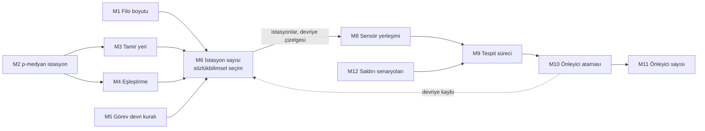

# Nöbetçi: Yöneylem Araştırması Modelleri

Bu belge, uygulamanın 7/24 güvenlik devriyesi ve dış drone saldırısı (tespit ve önleme) bölümlerinde kullandığı hesapları yöneylem araştırması model şablonuyla yazar: **kümeler, parametreler, karar değişkenleri, amaç fonksiyonu, kısıtlar** ve **çözüm yöntemi**.

Her modelin sonunda "Koddaki karşılığı" satırı, modelin `uygulama/index.html` içindeki hangi işlevle çözüldüğünü gösterir. Uygulama bazı modelleri tam (kesin) çözer, bazılarını sezgisel yöntem ya da benzetimle çözer; bu ayrım her modelde açıkça belirtilmiştir.

## İçindekiler

**A. 7/24 güvenlik devriyesi**
1. [M1 Filo boyutlandırma ve devriye yuvası kapasitesi](#m1-filo-boyutlandırma-ve-devriye-yuvası-kapasitesi)
2. [M2 Şarj ve kalkış istasyonu yerleşimi (p-medyan)](#m2-şarj-ve-kalkış-istasyonu-yerleşimi-p-medyan)
3. [M3 Tamir istasyonu yerleşimi (ağırlıklı 1-medyan)](#m3-tamir-istasyonu-yerleşimi-ağırlıklı-1-medyan)
4. [M4 Drone ile istasyon eşleştirme](#m4-drone-ile-istasyon-eşleştirme)
5. [M5 Görev devri ve yedek kaldırma kararı](#m5-görev-devri-ve-yedek-kaldırma-kararı)
6. [M6 İstasyon sayısının seçimi (benzetim tabanlı sözlükbilimsel optimizasyon)](#m6-istasyon-sayısının-seçimi-benzetim-tabanlı-sözlükbilimsel-optimizasyon)
7. [M7 Çevre devriyesinde eşit dağılım (hız kontrolü)](#m7-çevre-devriyesinde-eşit-dağılım-hız-kontrolü)

**B. Dış drone saldırısı: tespit ve önleme**
8. [M8 Sensör ve karıştırıcı yerleşimi (en büyük erken uyarı kapsaması)](#m8-sensör-ve-karıştırıcı-yerleşimi-en-büyük-erken-uyarı-kapsaması)
9. [M9 Tespit, doğrulama ve sınıflandırma olasılık modeli](#m9-tespit-doğrulama-ve-sınıflandırma-olasılık-modeli)
10. [M10 Önleyici drone ataması ve kesişme noktası](#m10-önleyici-drone-ataması-ve-kesişme-noktası)
11. [M11 Önleyici sayısının belirlenmesi (şans kısıtlı model)](#m11-önleyici-sayısının-belirlenmesi-şans-kısıtlı-model)
12. [M12 Saldırı senaryosu üretimi ve isteğe bağlı saldırılar](#m12-saldırı-senaryosu-üretimi-ve-isteğe-bağlı-saldırılar)

[Ortak gösterim ve ölçütler](#ortak-gösterim-ve-ölçütler) · [Modeller arası bağlantı](#modeller-arası-bağlantı)

---

## Ortak gösterim ve ölçütler

| Simge | Anlamı |
|---|---|
| $d(a,b)$ | İki nokta arasındaki düzlem (Öklid) uzaklığı, m |
| $T$ | Benzetim ufku (varsayılan 24 sa), s |
| $\Delta t$ | Benzetim adımı (devriyede 10 s, saldırıda 1 s) |
| $k$ | Aynı anda devriyede olması istenen drone (yuva) sayısı |
| $r$ | Her an hazır tutulması istenen yedek drone sayısı |
| $L$ | Kapalı devriye rotasının uzunluğu, m |
| $\Omega$ | Rastgele senaryolar (arıza veya saldırı) kümesi, $\omega \in \Omega$ |

**Devriye kapsaması** (güvenlik ölçütü): $o_j(t)=1$ ise yuva $j$ o anda doludur.

$$
\mathrm{Cov}(\omega)=\frac{1}{T-T_w}\int_{T_w}^{T}\frac{1}{k}\sum_{j=1}^{k}o_j(t,\omega)\,dt
$$

$T_w$ ilk kalkışların tamamlandığı ısınma süresidir. **Tam kapsama** $\mathrm{Full}(\omega)$, tüm yuvaların aynı anda dolu olduğu zaman payıdır. **Tekrar ziyaret süresi** $L/(k\,v_s)$ olur; burada $v_s$ ortak devriye hızıdır.

---

# A. 7/24 güvenlik devriyesi

## M1 Filo boyutlandırma ve devriye yuvası kapasitesi

Soru: $k$ yuvayı kesintisiz doldurmak ve $r$ yedek tutmak için en az kaç drone gerekir?

**Kümeler**
- $I$: filodaki uygun dronelar, $i \in I$, $n=|I|$

**Parametreler**
- $E_i^{u}$: kullanılabilir batarya enerjisi (rezerv düşülmüş), Wh
- $E_i^{c},E_i^{d}$: tırmanma ve iniş enerjisi, Wh
- $P_i^{on}$: devriye hızında güç, $P_i^{T}$: geçiş hızında güç, W
- $\bar v_i$: rüzgâr altında yönlerden ortalanmış yer hızı (harmonik ortalama), m/s
- $\bar d$: istasyondan rotaya ortalama uzaklık (M2 çıktısı), m
- $t_i^{c},t_i^{d}$: tırmanma ve iniş süresi; $t^{sw}$: batarya değişim süresi, s
- $b_i$: drone başına batarya sayısı; $t_i^{ch}$: şarj süresi, s
- $\mathrm{MTBF}$, $\mathrm{MTTR}$: arızalar arası ortalama uçuş süresi ve ortalama tamir süresi, sa
- $\varepsilon_i=0{,}03\,E_i^{u}$: güvenlik payı
- $\alpha=1{,}1$: yuva başına %10 devir payı

**Türetilen büyüklükler**

Görevde kalma süresi:

$$
t_i^{on}=\frac{E_i^{u}-\left(E_i^{c}+\tfrac{\bar d}{\bar v_i}P_i^{T}\right)-\left(\tfrac{\bar d}{\bar v_i}P_i^{T}+E_i^{d}\right)-\varepsilon_i}{P_i^{on}}
$$

Bir çevrim süresi ve şarj darboğazı dahil dönem:

$$
c_i=t_i^{on}+t_i^{c}+2\tfrac{\bar d}{\bar v_i}+t_i^{d}+t^{sw},\qquad
\pi_i=\max\!\left(c_i,\;\frac{c_i+0{,}85\,t_i^{ch}}{b_i}\right)
$$

Görev oranı, kullanılabilirlik ve etkin kapasite:

$$
\delta_i=\frac{t_i^{on}}{\pi_i},\qquad A_i=\frac{1}{1+\frac{\delta_i}{\mathrm{MTBF}}(\mathrm{MTTR}+0{,}3)},\qquad \kappa_i=\delta_i A_i
$$

**Karar değişkeni**
- $N \in \mathbb{Z}_{\ge 0}$: gereken drone sayısı

**Amaç fonksiyonu**

$$
\min\; N
$$

**Kısıtlar**

$$
N\,\bar\kappa \;\ge\; \alpha\,k+r\,\bar\kappa,\qquad \bar\kappa=\frac{1}{n}\sum_{i\in I}\kappa_i
$$

$$
t_i^{on}>0\quad \forall i \qquad\text{(batarya rotaya gidiş dönüşe yetmeli)}
$$

**Çözüm** kapalı biçimde bulunur: $N^*=\lceil \alpha k/\bar\kappa\rceil + r$. Eldeki filoyla sürekli sağlanabilen yuva sayısı da şöyledir: $k^{max}=\left\lfloor \big(\sum_i\kappa_i-r\,\bar\kappa\big)/\alpha \right\rfloor$.

**Koddaki karşılığı:** `planSecurity` içindeki "filo yeterliliği (analitik)" bloğu (`duty`, `needed`, `achievable`).

---

## M2 Şarj ve kalkış istasyonu yerleşimi (p-medyan)

**Kümeler**
- $I$: aday istasyon noktaları (alan içinde, sınırdan en az 8 m içeride, ızgara), $|I|\le 400$
- $J$: devriye rotası üzerinde eşit aralıklı talep noktaları, $|J|=120$

**Parametreler**
- $d_{ij}$: aday $i$ ile talep noktası $j$ arası uzaklık
- $w_j$: talep ağırlığı (rota boyunca eşit, $w_j=1$)
- $m$: açılacak istasyon sayısı (M6 tarafından belirlenir)
- $c$: istasyon başına şarj yuvası sayısı
- $R^{min}=\min_i \frac{E_i^{u}}{P_i^{T}}\bar v_i$: filonun en kısa menzili

**Karar değişkenleri**
- $y_i\in\{0,1\}$: $i$ adayında istasyon açılırsa 1
- $x_{ij}\in\{0,1\}$: talep noktası $j$, $i$ istasyonundan hizmet alırsa 1

**Amaç fonksiyonu** (rotaya ortalama erişim uzaklığını en aza indir):

$$
\min \; Z=\sum_{i\in I}\sum_{j\in J} w_j\, d_{ij}\, x_{ij}
$$

**Kısıtlar**

$$
\sum_{i\in I} x_{ij}=1 \quad \forall j\in J
$$

$$
x_{ij}\le y_i \quad \forall i\in I,\ j\in J
$$

$$
\sum_{i\in I} y_i = m
$$

$$
x_{ij},\,y_i\in\{0,1\}
$$

**İstasyon sayısının alt sınırı** (M6'nın arama aralığını belirler):

$$
m \;\ge\; m^{min}=\max\!\Big(\big\lceil n/c\big\rceil,\; 2\cdot\mathbb{1}[n\ge 4 \wedge c\ge 2]\Big)
$$

Ayrıca menzil kısıtı sağlanana kadar $m$ artırılır:

$$
\max_{j\in J}\;\min_{i:\,y_i=1} d_{ij}\;\le\; 0{,}25\,R^{min}
$$

**Çözüm yöntemi:** Önce açgözlü başlangıç kullanılır: her adımda $Z$'yi en çok düşüren aday eklenir. Sonra Teitz-Bart takas iyileştirmesi uygulanır: açık bir istasyon kapalı bir adayla değiştirilir ve iyileşme bitene kadar (en fazla 12 tur) sürer. Bu yöntem sezgiseldir, en iyiyi garanti etmez; küçük örneklerde genellikle en iyiye çok yakındır.

**Koddaki karşılığı:** `siteCandidates`, `pMedian`, `planSecurity` içindeki `mMin` döngüsü.

---

## M3 Tamir istasyonu yerleşimi (ağırlıklı 1-medyan)

Arızalı drone rotanın herhangi bir yerinde düşebilir; tamirden sonra kendi istasyonuna teslim edilir.

**Kümeler**
- $I$: aday noktalar (M2 ile aynı), $J$: rota talep noktaları, $S$: açılmış şarj istasyonları

**Parametreler**
- $d(i,q_j)$: aday ile rota noktası uzaklığı
- $d(i,s)$: aday ile istasyon $s$ uzaklığı
- $n_s$: istasyon $s$'e bağlı drone sayısı; $n=\sum_s n_s$

**Karar değişkeni**
- $z_i\in\{0,1\}$: tamir istasyonu $i$ adayına kurulursa 1

**Amaç fonksiyonu** (beklenen kurtarma ve teslim yolu):

$$
\min \sum_{i\in I} z_i\left[\frac{2}{|J|}\sum_{j\in J} d(i,q_j)+\sum_{s\in S}\frac{n_s}{n}\,d(i,s)\right]
$$

İlk terim arıza noktasına gidiş ve dönüşü, ikinci terim istasyonlara teslim yolunu (drone sayısıyla ağırlıklı) temsil eder.

**Kısıtlar**

$$
\sum_{i\in I} z_i = 1,\qquad z_i\in\{0,1\}
$$

**Çözüm yöntemi:** Tek tesis olduğu için tüm adaylar taranır; bu ayrık aday kümesi üzerinde **kesin en iyi** çözümdür.

**Koddaki karşılığı:** `repairFor` (`planSecurity` içinde).

---

## M4 Drone ile istasyon eşleştirme

Amaç, her istasyona benzer sayıda ve karışık verimlilikte drone düşmesidir. Böylece tek istasyonda yalnız verimsiz dronelar toplanmaz.

**Kümeler**
- $I$: dronelar, $S$: istasyonlar, $|S|=m$

**Parametreler**
- $e_i=P_i^{on}/E_i^{u}$: birim enerji başına güç tüketimi (küçük olan daha verimli)
- $\rho(i)$: dronların $e_i$'ye göre artan sıradaki konumu

**Karar değişkenleri**
- $a_{is}\in\{0,1\}$: drone $i$ istasyon $s$'e bağlanırsa 1

**Amaç fonksiyonu** (yük ve verim dengesi):

$$
\min\;\max_{s\in S}\Big|\sum_{i} a_{is}\,e_i-\frac{1}{m}\sum_i e_i\Big|
$$

**Kısıtlar**

$$
\sum_{s\in S} a_{is}=1\quad\forall i,\qquad
\Big\lfloor \tfrac{n}{m}\Big\rfloor\le \sum_{i} a_{is}\le \Big\lceil \tfrac{n}{m}\Big\rceil\quad\forall s
$$

**Çözüm yöntemi:** Dronlar $e_i$'ye göre sıralanır ve sırayla dağıtılır: $a_{is}=1 \iff s=\rho(i)\bmod m$. Bu kural sayı kısıtını kesin sağlar, verim dengesini yaklaşık sağlar.

**Koddaki karşılığı:** `order` ve `buildCfg` (`planSecurity` içinde).

---

## M5 Görev devri ve yedek kaldırma kararı

Bu bir **çevrimiçi (dinamik) karar kuralıdır**; her benzetim adımında $t$ anındaki duruma göre verilir.

**Kümeler**
- $J=\{1,\dots,k\}$: devriye yuvaları
- $H(t)$: $t$ anında istasyonda hazır bekleyen dronelar

**Parametreler ve durum**
- $p_j(t)$: yuva $j$'nin rota üzerindeki konumu; yuvalar $L/k$ aralıkla, $v_s$ hızıyla döner
- $\eta_{hj}(t)$: hazır drone $h$'nin yuva $j$'ye varış süresi (hareketli hedef, iki adım düzeltmeli):

$$
\eta^{(0)}=t^{c}_h+\frac{d\big(s_h,p_j(t)\big)}{\bar v_h},\qquad
\eta_{hj}=t^{c}_h+\frac{d\big(s_h,p_j(t+\eta^{(0)})\big)}{\bar v_h}
$$

- Görevdeki drone $o$ için ayrılmaya kalan süre:

$$
\tau_o(t)=\frac{E_o^{u}-E_o^{used}(t)-E_o^{ret}(t)-\varepsilon_o}{P_o^{on}},\qquad
E_o^{ret}=\frac{d(\text{konum},s_o)}{\bar v_o}P_o^{T}+E_o^{d}
$$

- $\mu$: devir payı (varsayılan 3 dk)

**Karar değişkeni**
- $u_{hj}(t)\in\{0,1\}$: $t$ anında $h$ dronu $j$ yuvası için kalkarsa 1

**Amaç fonksiyonu** (her yuva için en hızlı yetişen yedek):

$$
\min \sum_{j}\sum_{h\in H(t)} \eta_{hj}(t)\,u_{hj}(t)
$$

**Kısıtlar**

$$
\sum_{h} u_{hj}(t)\le 1\ \ \forall j,\qquad \sum_{j} u_{hj}(t)\le 1\ \ \forall h
$$

$$
u_{hj}(t)=0 \quad\text{eğer } j \text{ dolu ve } \tau_{o(j)}(t) > \eta_{hj}(t)+\mu \qquad\text{(erken kalkış yok)}
$$

$$
u_{hj}(t)=0 \quad\text{eğer } j \text{ yuvasına zaten bir drone yoldaysa}
$$

Boş yuva varsa koşulsuz kalkış yapılır; güvenlik için son yedek de kullanılabilir.

**Batarya ve şarj kısıtı:** İstasyon $s$'deki $c$ şarj yuvası ilk gelen ilk çıkar (FIFO) kuralıyla çalışır. Şarjlı yedek batarya yoksa drone şarjın bitmesini bekler:

$$
t^{ready}_h=\max\big(t^{land}_h+t^{sw},\ \min_{q\le c} \text{şarj yuvası } q \text{ boşalma anı} + t^{ch}_h\big)
$$

**Çözüm yöntemi:** Yuva yuva açgözlü seçim yapılır ($\arg\min_h \eta_{hj}$). Kural, ayrık olay benzetimi (10 s adım) içinde uygulanır.

**Koddaki karşılığı:** `runSecurity` içindeki "2) dağıtım" bloğu, `launch`, `eRet`, `chargers`.

---

## M6 İstasyon sayısının seçimi (benzetim tabanlı sözlükbilimsel optimizasyon)

Güvenlik önce gelir. Bu yüzden amaçlar ağırlıklı toplanmaz, **sözlükbilimsel (lexicographic)** sırayla karşılaştırılır.

**Kümeler**
- $M=\{m^{min},\dots,m^{max}\}$, $m^{max}=\min(m^{cap},\,n,\,m^{min}+2,\,|I|)$
- $\Omega$: rastgele arıza senaryoları, $|\Omega|$ = deneme sayısı (varsayılan 12)

**Parametreler (stokastik)**
- Arıza süreci: uçuştaki her drone için adım başına arıza olasılığı $\Delta t/(\mathrm{MTBF}\cdot 3600)$; yani arızalar arası süre üsteldir, $\lambda=1/\mathrm{MTBF}$
- Kritik arıza olasılığı $p^{cr}$: kritik arızada acil iniş, kurtarma aracı ($v_g$, yol katsayısı 1,4) ile tamire taşıma; hafif arızada drone uçarak tamire gider
- Tamir süresi $\mathrm{MTTR}$, sonra istasyona teslim

**Karar değişkeni**
- $m\in M$: istasyon sayısı (yerleşim M2, eşleştirme M4, tamir M3 ile belirlenir)

**Amaç fonksiyonları** (öncelik sırasıyla):

$$
\operatorname{lex\,opt}_{m\in M}\Big(
\underbrace{\max\ Q_{0{,}10}\big[\mathrm{Cov}(m,\omega)\big]}_{1.\ \text{kötü senaryo güvenliği}},\;
\underbrace{\max\ \mathbb{E}_\omega\big[\mathrm{Res}(m,\omega)\big]}_{2.\ \text{hazır yedek}},\;
\underbrace{\min\ \mathbb{E}_\omega\big[E(m,\omega)\big]}_{3.\ \text{enerji}},\;
\underbrace{\min\ m}_{4.\ \text{yatırım}}
\Big)
$$

- $Q_{0{,}10}$: kapsamanın %10'luk alt yüzdeliği (en kötü senaryoların sınırı)
- $\mathrm{Res}$: en az $r$ hazır yedeğin bulunduğu zaman payı
- $E$: toplam enerji, Wh

Karşılaştırmada küçük farklar yuvarlanır: kapsama 1/400, yedek payı 1/100 duyarlılıkla ele alınır. Böylece anlamsız küçük kapsama farkı enerjiyi ezmez.

**Kısıtlar**
- M2, M3, M4 kısıtları
- M5 işletme kuralları (benzetim modeli)

**Çözüm yöntemi:** Her $m\in M$ için $|\Omega|$ Monte Carlo benzetimi koşulur ve aynı tohumlarla ortak rastgele sayılar kullanılır. Sonra sözlükbilimsel sıralamada ilk gelen düzen seçilir. Bu, benzetimle optimizasyondur (simulation optimization); $|M|\le 3$ olduğu için tam sayım yapılır.

**Koddaki karşılığı:** `planSecurity` içindeki `configs` döngüsü ve `rk` sıralama anahtarı; `runSecurity`.

---

## M7 Çevre devriyesinde eşit dağılım (hız kontrolü)

Dronelar aynı kapalı halkada aynı yönde döner. Amaç, aralarındaki boşlukların eşit kalması ve böylece çevrenin en geniş görüşle izlenmesidir.

**Parametreler**
- $L$: halka uzunluğu; $m(t)$: o anda görevdeki drone sayısı
- $G=L/m(t)$: hedef (eşit) aralık
- $v^{ref}$: ortak referans hız; $[v_i^{min},v_i^{max}]$: drone hız sınırları ($0{,}6\,v^{ref}\le v\le 1{,}35\,v^{ref}$, sabit kanatta $v\ge 1{,}1\,v^{stall}$)
- $K=0{,}8$: kontrol kazancı

**Durum değişkenleri**
- $s_i(t)$: drone $i$'nin halka üzerindeki konumu (yay uzunluğu)
- $g_i(t)=\big(s_{i+1}(t)-s_i(t)\big)\bmod L$: önündeki drone ile arası

**Karar değişkeni**
- $v_i(t)$: drone $i$'nin hızı

**Amaç fonksiyonu** (aralıkların düzgünlüğü):

$$
\min \int_0^T \sum_{i=1}^{m(t)}\big(g_i(t)-G\big)^2\,dt
$$

Buna eşdeğer olarak anlık görüş kapsaması en büyüklenir.

**Kısıtlar**

$$
\dot s_i=v_i,\qquad v_i^{min}\le v_i\le v_i^{max},\qquad \sum_{i} g_i(t)=L
$$

**Çözüm yöntemi:** Oransal geri besleme kuralı kullanılır:

$$
v_i(t)=\operatorname{clip}\!\Big(v^{ref}\big(1+K\,\tfrac{g_i(t)-G}{G}\big),\ v_i^{min},\ v_i^{max}\Big)
$$

Önündeki boşluk büyükse drone hızlanır, küçükse yavaşlar. Yeni kalkan drone en büyük boşluğun ortasına katılır:

$$
s^{join}=\arg\max_i g_i \text{ aralığının orta noktası}
$$

İlk dalga eşit aralıkla yerleşir, ilk batarya bütçeleri kademelendirilir: $B_i=E_i^{u}\,(1-0{,}75\,i/n)$. Böylece dönüşler aynı anda olmaz.

**Koddaki karşılığı:** `perimeterPatrol` (dağılım kontrolü, `largestGapMid`, `budget`).

---

# B. Dış drone saldırısı: tespit ve önleme

## M8 Sensör ve karıştırıcı yerleşimi (en büyük erken uyarı kapsaması)

Bir saldırgan drone merkeze doğru 36 farklı yönden ve farklı profillerle gelebilir. Her yön ve profil için tehdidin **ne kadar uzaktan** fark edildiği en büyüklenir.

**Kümeler**
- $I$: aday sensör noktaları (M2 adayları)
- $\Theta=\{\tau\}$: sensör türleri (radar, RF dedektör, EO/IR kamera, akustik); karıştırıcı ayrı yerleştirilir
- $K=\{0^\circ,10^\circ,\dots,350^\circ\}$: yaklaşma yönleri, $|K|=36$
- $Q$: tehdit profilleri $\{(80\,\text{m},\ \text{RF bağlantılı}),\ (25\,\text{m},\ \text{RF bağlantılı}),\ (80\,\text{m},\ \text{otonom})\}$

**Parametreler**
- $N_\tau$: kullanıcının belirlediği $\tau$ türü sensör sayısı
- $C$: alan merkezi; $R^{s}$: doğma yarıçapı (alanın en uzak noktası + 2,5 km)
- $u_k=(\sin\theta_k,\cos\theta_k)$: $k$ yönünün birim vektörü
- Etkin menzil $R_{\tau q}$ (irtifa $z_q$, otonomluk $a_q$):

$$
R_{\text{radar},q}=R_r\,(0{,}6)^{\mathbb{1}[z_q<35]},\quad
R_{\text{RF},q}=R_{rf}\,(1-a_q),\quad
R_{\text{EO},q}=R_{eo}\,(0{,}8)^{\mathbb{1}[z_q<35]},\quad
R_{\text{ak},q}=R_{ak}
$$

Sabit kanatlı tehditte radar ×1,4, EO ×1,2, akustik ×0,7 uygulanır.

- **Erken uyarı mesafesi** $E_{i\tau qk}$: merkeze $k$ yönünden gelen tehdidin, $i$ noktasındaki $\tau$ sensörünün menziline ilk girdiği andaki merkezden uzaklığıdır. Doğru-çember kesişiminin büyük kökü olarak bulunur:

$$
\lVert C+s\,u_k-S_i\rVert = R_{\tau q}\ \Rightarrow\
s^2+b\,s+c=0,\quad b=2\,u_k\!\cdot(C-S_i),\quad c=\lVert C-S_i\rVert^2-R_{\tau q}^2
$$

$$
E_{i\tau qk}=\min\!\Big(R^{s},\ \max\big(0,\tfrac{-b+\sqrt{b^2-4c}}{2}\big)\Big)\quad(\text{diskriminant}<0\Rightarrow 0)
$$

**Karar değişkenleri**
- $y_{i\tau}\in\{0,1\}$: $i$ noktasına $\tau$ sensörü konursa 1
- $e_{qk}\ge 0$: $q$ profili ve $k$ yönü için elde edilen erken uyarı mesafesi
- $e^{min}\ge 0$: en kötü yön ve profilin erken uyarı mesafesi

**Amaç fonksiyonu** (ortalama erken uyarı + en kötü yön):

$$
\max\ \ \frac{1}{|Q|\,|K|\,R^{s}}\sum_{q\in Q}\sum_{k\in K} e_{qk}\;+\;0{,}5\,\frac{e^{min}}{R^{s}}
$$

**Kısıtlar**

$$
e_{qk}\le \max_{i,\tau}\ y_{i\tau}\,E_{i\tau qk}\quad \forall q,k
$$

Doğrusallaştırılmış hali, $w_{i\tau qk}\in\{0,1\}$ "bu yön ve profili en iyi gören sensör" değişkeniyle şöyledir:

$$
e_{qk}\le \sum_{i,\tau} E_{i\tau qk}\,w_{i\tau qk},\quad \sum_{i,\tau} w_{i\tau qk}\le 1,\quad w_{i\tau qk}\le y_{i\tau}
$$

$$
e^{min}\le e_{qk}\quad\forall q,k
$$

$$
\sum_{i\in I} y_{i\tau}=N_\tau\quad\forall\tau,\qquad y_{i\tau}\in\{0,1\}
$$

**Çözüm yöntemi:** Sıralı açgözlü seçim yapılır: her sensör, o ana kadarki yerleşime en çok katkıyı veren adaya konur. Aynı türün üst üste yığılmaması için küçük bir ayrışma ödülü eklenir: $+0{,}02\min(1,\ \text{en yakın sensöre uzaklık}/300)$. Amaç fonksiyonunun ortalama terimi alt modüler (submodular) olduğu için açgözlü seçim, en iyinin en az $(1-1/e)\approx\%63$'ünü garanti eder (Nemhauser, Wolsey, Fisher, 1978); en kötü yön terimi için bu garanti yoktur.

**Karıştırıcı** aynı modelle ama yalnız RF bağlantılı iki profil için ($Q=\{(80,0),(25,0)\}$) yerleştirilir; çünkü otonom drona etkisizdir.

**Kör sektör çıktısı:** Her $k$ yönü için $e_{qk}$ değerleri kutup grafiğinde çizilir; içe çöken yönler kör sektördür.

**Koddaki karşılığı:** `defEffR`, `entry`, `placeGreedy`, `sectors` (`planDefense` içinde).

---

## M9 Tespit, doğrulama ve sınıflandırma olasılık modeli

Bu bir optimizasyon değil, M10 ve M11'in kullandığı **stokastik süreç modelidir** (parametre katmanı).

**Parametreler**
- $P_\tau$: menzilin yakın bölgesinde saniyelik tespit olasılığı. Varsayılanlar: radar 0,7; RF 0,85; EO 0,5; akustik 0,5; devriye kamerası (400 m) 0,5
- $N^{trk}$: radarın aynı anda izleyebileceği hedef sayısı
- $t^{rx}$: karar süresi (angajman kuralı)

**Saniyelik tespit olasılığı** ($d$: sensör ile tehdit arası uzaklık, $R=R_{\tau q}$):

$$
p_\tau(d)=P_\tau\cdot
\begin{cases}
1, & d<0{,}6R\\[2pt]
\dfrac{R-d}{0{,}4R}, & 0{,}6R\le d\le R\\[2pt]
0, & d>R
\end{cases}
\ \cdot\ \underbrace{\min\!\Big(1,\frac{N^{trk}}{\ell_\text{radar}(t)}\Big)}_{\text{yalnız radar}}
\ \cdot\ \underbrace{0{,}4^{\,\mathbb{1}[\text{henüz iz yok}]}}_{\text{yalnız EO}}
$$

$\ell_\text{radar}(t)$: o anda radar menzilindeki hedef sayısıdır (doygunluk).

**Olay zamanları:**
- **İlk iz:** $t^{1}=\min\{t:\ \text{herhangi bir sensör tespit etti}\}$
- **Doğrulama:** $t^{cf}=\min\{t\ge t^{1}:\ |\text{tespit eden türler}|\ge 2\ \vee\ \text{radar tespiti}\ge 3\ \vee\ \text{RF, EO veya devriye gördü}\}$
- **Sınıflandırma:** $t^{cl}=\min\{t\ge t^{1}:\ \text{EO, RF veya devriye imzası}\ \vee\ \text{tehdit sınırı geçti}\}$
- **Müdahale izni:** $t^{eng}=t^{cl}+t^{rx}$
- **Erken uyarı süresi:** $W=$ $t^{1}$ anında tehdidin hedefe kalan uçuş süresi (bekleme süreleri dahil)

Doğrulanmış ama görsel tanımlaması olmayan ize en yakın serbest devriye dronu yönlendirilir (16 m/s). Ayrılınan süre "devriye kaybı" olarak ölçülür ve M6'daki güvenlik kapsamasıyla takas oluşturur.

**Koddaki karşılığı:** `runSim` içindeki "3) tespit" bloğu, `SENSOR_P`, `remainingTime`.

---

## M10 Önleyici drone ataması ve kesişme noktası

**Kümeler**
- $U$: önleyici dronlar (istasyonlara dağıtılmış), $u\in U$
- $\Phi(t)$: $t$ anında müdahale izni almış ($t\ge t^{eng}_\phi$), canlı ve atanmamış tehditler

**Parametreler**
- $v_I$: önleyici hızı; $p^{net}$: ağla yakalama olasılığı; deneme sayısı en çok 3, denemeler arası 8 s
- Kalkış 10 s, yeniden donanma 120 s
- $\mathrm{TTG}_\phi(t)$: tehdidin hedefe kalan süresi (time-to-go)
- RF karıştırıcı: menzil $R_j$, başarı $p^{jam}$, 5 s'de bir dener; otonom tehdide etkisiz

**Karar değişkeni**
- $x_{u\phi}(t)\in\{0,1\}$: hazır önleyici $u$, $t$ anında tehdit $\phi$'ye atanırsa 1

**Amaç fonksiyonu** (en acil tehdidi önce karşıla; aciliyet, hedefe kalan sürenin tersidir):

$$
\max \sum_{u}\sum_{\phi\in\Phi(t)} \frac{1}{\mathrm{TTG}_\phi(t)}\, x_{u\phi}(t)
$$

Pratikte bu, hazır önleyicilerin sırayla $\arg\min_\phi \mathrm{TTG}_\phi$ tehdidine atanmasıdır (en erken bitiş tarihi kuralı).

**Kısıtlar**

$$
\sum_{\phi} x_{u\phi}\le 1\ \ \forall u \qquad \sum_{u} x_{u\phi}\le 1\ \ \forall \phi
$$

$$
x_{u\phi}=0\quad\text{eğer } u \text{ kalkışta, takipte, dönüşte veya yeniden donanmada ise}
$$

**Kesişme noktası (öncül takip):** Tehdidin hız vektörü $\mathbf v_\phi$, göreli konum $\mathbf r=\mathbf p_\phi-\mathbf p_u$ olsun. Kesişme süresi $\tau$ şu denklemin en küçük pozitif köküdür:

$$
\lVert \mathbf r+\mathbf v_\phi\tau\rVert=v_I\,\tau
\ \Rightarrow\
\underbrace{(\lVert\mathbf v_\phi\rVert^2-v_I^2)}_{a}\tau^2+\underbrace{2\,\mathbf r\cdot\mathbf v_\phi}_{b}\,\tau+\underbrace{\lVert\mathbf r\rVert^2}_{c}=0
$$

Önleyici $\mathbf p_\phi+\mathbf v_\phi\tau$ noktasına yönelir ($0<\tau<120$ s değilse doğrudan tehdide). 20 m içinde yakalama denemesi Bernoulli($p^{net}$) olarak modellenir.

**Ortak kaynak (isteğe bağlı saldırılar):** Birden çok saldırı tek benzetimde çalışır. Önleyiciler, sensörler ve karıştırıcılar tüm saldırılarda ortaktır; önceki saldırıda yeniden donanan önleyici, sonraki saldırı için kullanılamaz.

**Koddaki karşılığı:** `runSim` içindeki "4) etkisizleştirme" ve "5) önleyici dronlar" blokları, `aimAt`, `stepTo`.

---

## M11 Önleyici sayısının belirlenmesi (şans kısıtlı model)

**Kümeler**
- $\mathcal S$: seçili saldırı senaryoları (tekil, alçak irtifa, sürü, çok yönlü, yem, bekleme, sabit kanat)
- $\Omega_s$: her senaryo için rastgele denemeler (yön, irtifa, hız, hedef, otonomluk rastgele)

**Parametreler**
- $\bar h_s$: senaryo $s$'deki ortalama tehdit sayısı (ağırlık)
- $\beta=0{,}05$: kabul edilebilir sızma oranı
- $N^{max}=\min(12,\ N_I^{0}+4)$; $N_I^{0}$: kullanıcının girdiği önleyici sayısı

**Karar değişkeni**
- $N_I\in\{0,1,\dots,N^{max}\}$: önleyici drone sayısı

**Amaç fonksiyonu**

$$
\min\ N_I
$$

**Kısıt** (şans kısıtı; tehdit sayısıyla ağırlıklı sızma olasılığı):

$$
\Lambda(N_I)=\frac{\sum_{s\in\mathcal S}\bar h_s\ \Pr\big[\text{tehdit korunan noktaya ulaşır}\mid s,N_I\big]}{\sum_{s}\bar h_s}\ \le\ \beta
$$

**Çözüm yöntemi:** Olasılık Monte Carlo ile tahmin edilir:

$$
\hat\Lambda(N_I)=\frac{\sum_s\sum_{\omega\in\Omega_s}\#\{\text{sızan tehdit}\}}{\sum_s\sum_{\omega}\#\{\text{tehdit}\}}
$$

$N_I$ küçükten büyüğe taranır; kısıtı sağlayan ilk değer önerilir. Hiçbiri sağlamazsa en büyük değer raporlanır ve "tek başına önleyici artırmak yetmiyor, daha erken tespit ve ikinci bir etkisizleştirme katmanı gerekir" uyarısı verilir. Bu, duyarlılık analizi tablosudur.

**Senaryo başına ölçütler** (her biri $\Omega_s$ üzerinden ortalama):
- tespit oranı, tespit mesafesi $\mathbb E[d(t^{1})]$, erken uyarı $\mathbb E[W]$
- etkisizleştirme ve sızma oranı, hiç sızmasız deneme oranı
- yem senaryosunda asıl tehdidin sızma oranı
- otonom tehdit sızma oranı, devriye kaybı

**Koddaki karşılığı:** `agg`, `sensitivity`, `recommendedInterceptors` (`planDefense` içinde).

---

## M12 Saldırı senaryosu üretimi ve isteğe bağlı saldırılar

Bu bölüm M10 ve M11'deki $\Omega$ kümesini tanımlar: savunma modelinin "talep" tarafıdır. Saldırgan bir optimizasyon yapmaz. Kullanıcı ya da rastgele üreteç saldırı planını belirler.

**Saldırı planı** $\mathcal A=\{(t_0^{a},\ \{w\}_{a})\}$: her saldırı $a$ bir başlangıç anı ve dalgalardan oluşur. Her dalga $w$ şunları taşır:

| Parametre | Anlamı | Aralık |
|---|---|---|
| $\sigma_w$ | senaryo türü | 7 tür veya rastgele |
| $\theta_w$ | geliş yönü (merkeze göre) | $[0,360)$ veya rastgele, haritadan seçilebilir |
| $n_w$ | drone sayısı | 1-20 veya senaryo varsayılanı |
| $\delta_w$ | gecikme | 0-1800 s |
| $a_w$ | bağlantı | karışık (%$p^{auto}$ otonom), otonom, RF bağlantılı |

Tehdit $\phi$'nin doğma noktası, yanal kayması $\ell_\phi$ ile şöyledir:

$$
\mathbf p_\phi(0)=C+R^{s}\,u(\theta_\phi)+\ell_\phi\,u^{\perp}(\theta_\phi)
$$

Başlangıç anı $t_0^{a}+\delta_w+\xi_\phi$ olur; $\xi_\phi$ senaryoya özgü küçük dağılmadır. Hedef korunan noktalardan rastgele seçilir: istasyonlar, tamir istasyonu, alan merkezi, ilgi noktaları.

**Rastgele saldırı üreteci:**

$$
|w|\sim U\{1,2,3\},\qquad
\theta_i=\theta_0+i\,\frac{360}{|w|}+U(-25,25),\qquad
\delta_1=0,\ \delta_{i>1}\sim U\{0,\dots,45\}
$$

Bu kurala göre dalgalar arası açı farkı en az $360/3-50=70^\circ\ge 60^\circ$ olur; yani dalgalar aynı anda farklı yerlerden gelir.

**Geçmişin korunması:** Her tehdidin kendi rastgele sayı akışı vardır: tohum $=$ saldırı tohumu $\oplus\ (k+1)\cdot 2654435761$. Sonradan eklenen saldırı, eklenme anından önceki olayları değiştirmez.

**Koddaki karşılığı:** `genThreats`, `randomAttack`, `simulateAttacks`.

---

## Modeller arası bağlantı

| Model | Tür | Çözüm |
|---|---|---|
| M1 | Tam sayılı, tek değişkenli | Kapalı biçim (kesin) |
| M2 | p-medyan (tam sayılı doğrusal) | Açgözlü + Teitz-Bart (sezgisel) |
| M3 | Ağırlıklı 1-medyan | Tam sayım (kesin) |
| M4 | Dengeli atama | Sıralı dağıtım kuralı (sezgisel) |
| M5 | Çevrimiçi atama / dinamik karar | Açgözlü kural, ayrık olay benzetimi |
| M6 | Stokastik, sözlükbilimsel çok amaçlı | Benzetimle optimizasyon, tam sayım |
| M7 | Optimal kontrol | Oransal geri besleme |
| M8 | En büyük kapsama (alt modüler) | Açgözlü, $(1-1/e)$ garantili kısım |
| M9 | Stokastik süreç | Monte Carlo |
| M10 | Dinamik atama + kesişme geometrisi | En erken bitiş tarihi kuralı, kapalı biçim kesişme |
| M11 | Şans kısıtlı tam sayılı | Monte Carlo + tarama |
| M12 | Senaryo üretimi | Rastgele / kullanıcı planı |

**Kaynaklar** (yöntemler için):
- Hakimi, S. L. (1964). Optimum locations of switching centers and the absolute centers and medians of a graph. *Operations Research* 12(3), 450-459. (p-medyan)
- Teitz, M. B., Bart, P. (1968). Heuristic methods for estimating the generalized vertex median of a weighted graph. *Operations Research* 16(5), 955-961. (takas iyileştirmesi)
- Nemhauser, G. L., Wolsey, L. A., Fisher, M. L. (1978). An analysis of approximations for maximizing submodular set functions. *Mathematical Programming* 14, 265-294. (açgözlü $(1-1/e)$ garantisi)
- Church, R., ReVelle, C. (1974). The maximal covering location problem. *Papers of the Regional Science Association* 32, 101-118. (en büyük kapsama)
- Charnes, A., Cooper, W. W. (1959). Chance-constrained programming. *Management Science* 6(1), 73-79. (şans kısıtı)
- Park, S. ve ark. (2021). Survey on Anti-Drone Systems. *IEEE Access* 9, 42635-42659. (tespit ve önleme katmanları)
